<div align="center">

<picture><source media="(max-width: 640px) and (prefers-color-scheme: dark)" srcset=".github/readme/header-phone-dark.svg"><source media="(max-width: 640px)" srcset=".github/readme/header-phone-light.svg"><source media="(prefers-color-scheme: dark)" srcset=".github/readme/header-dark.svg"></picture>

</div>

Deterministic, fully-local historical market simulation framework spanning 2015–2025.

LLM-driven semantic alpha extraction (**Module I**) → vectorized quantitative backtests (**Module II**) → Unreal Engine 5 digital twin visualization (**Module III**). Closed-loop, single-node, zero-cloud-dependency architecture.

## Status

**Pre-hardware bootstrap phase.** The Sovereign Lab compute substrate (RTX 5090 / Ryzen 9 9950X3D / 128 GB DDR5 / 4 TB PCIe Gen5 NVMe) has not yet arrived. Active work focuses on every component buildable on current hardware: Module II (CPU-bound) in full, Module I plumbing, Module III UE5 scaffolding, the persona library, the synthetic Alpha Ledger generator, and the CI / lockfile / future-leak test infrastructure. When hardware lands, the work is "swap the model, point at the full corpus, press run" — not "build the system."

## How it's built

<div align="center">

<picture><source media="(max-width: 640px) and (prefers-color-scheme: dark)" srcset=".github/readme/architecture-phone-dark.svg"><source media="(max-width: 640px)" srcset=".github/readme/architecture-phone-light.svg"><source media="(prefers-color-scheme: dark)" srcset=".github/readme/architecture-dark.svg"></picture>

</div>

## Layout

```
modules/
  module_1_extraction/   Async semantic extraction → Alpha Ledger
  module_2_quant/        Polars + as_of_join backtest engine
  module_3_twin/         Unreal Engine 5 digital twin (ZMQ + MessagePack)
shared/
  schemas/               Pydantic / Pandera contracts (Alpha Ledger, bridge messages)
  manifests/             Reproducibility — content-addressed run hashing
tests/                   Unit + property-based + temporal-firewall leak tests
```

## Sacrosanct invariants

- **Temporal firewall.** `as_of_join` only on monotonic timestamps; build-breaking if violated.
- **Iterative determinism.** Every run is byte-reproducible from `(corpus_hash, persona_hash, model_hash, seed, library_lockfile)`.
- **Schema as contract.** Pydantic at Python boundaries, MessagePack structs at the UE5 bridge; schema drift = build failure.

## Quickstart

```bash
uv sync --all-extras
make bootstrap-test    # end-to-end §0.5.3 smoke (synthetic ledger -> backtest -> bus)
make ci                # lint + tests + bootstrap-test
make test              # tests only
make lint              # ruff
```

`bootstrap-test` exercises the full pipeline against synthetic data and finishes in seconds. It is the canonical proof that the harness is wired correctly before any real-data run.

## Operations

- [`docs/architecture.md`](docs/architecture.md) — C4 diagrams (Context / Containers / Components) of the system.
- [`docs/adr/`](docs/adr/) — Architecture Decision Records.
- [`docs/HARDWARE_ARRIVAL_DAY.md`](docs/HARDWARE_ARRIVAL_DAY.md) — point-and-shoot procedure for transitioning from bootstrap state (synthetic everything) to Sovereign state (DeepSeek-R1 32B over the real 1.8M-doc corpus) when the 5090 / 9950X3D / 128GB / Gen5 stack lands.

Built by [Ali Arbab](https://github.com/thealiarbab), Founder of StockSaathi.
